# Where a translation comes from

The word card runs in the reader's browser. It shows what a word means in the reader's
language. To find that meaning, the browser and the server try several sources in a fixed
order, and they use the first source that has the answer. On the server, the route's
function `gtx()` tries two sources for every answer it needs from Google. When a
translation goes through English, each English step on the server tries the same two
sources. In the end the card shows up to three lines in the browser.

```mermaid
---
config:
  flowchart:
    wrappingWidth: 300
    nodeSpacing: 40
    rankSpacing: 44
    subGraphTitleMargin:
      top: 0
      bottom: 14
---
flowchart TD
  ask["In the browser, the word card asks for the translation of ‹word› from ‹source› into ‹target›.<br/>It asks only when the target language differs from the source language."]
  memo["The card first looks in glossCache, a memory inside the browser tab.<br/>That memory holds the answers this tab has already received, for words that have one casing.<br/>If the answer is there, the card shows it at once, and the server is not asked."]
  req["Otherwise the browser sends GET /api/translate/‹word› with source, target and dict=1 to the server.<br/>It sends one request for each casing of a word, such as Essen and essen.<br/>At Vercel's edge, the firewall refuses an address after 100 requests in a minute, with a 403."]
  cdn["At Vercel's edge, the CDN looks for an answer to the same URL from the same deployment.<br/>If it has one, it sends that answer, and the server is not asked.<br/>A deploy empties it, and it may drop an answer sooner."]
  hop["On the server, the route's gate refuses a request that the card could not have made, with a 400.<br/>Otherwise the route calls gtx(word, source, target).<br/>When neither language is English, the server also calls gtx(word, source, en) at the same time."]
  ask --> memo
  memo -- "The answer is not in the browser tab's memory." --> req
  req -- "The firewall lets the request through." --> cdn
  cdn -- "The CDN does not have the answer." --> hop

  subgraph gtx ["Server: gtx(), in order"]
    s1["Step 1: The server looks in Next's data cache, which Vercel keeps for the server.<br/>The cache may keep an answer for 180 days, which is revalidate.<br/>In practice Vercel drops the entries within hours."]
    s2["Step 2: The server asks Google at translate.googleapis.com.<br/>It asks for the translation, dt=t, and for the dictionary block, dt=bd."]
    s1 -- "The data cache does not have the answer." --> s2
  end

  hop --> s1
  gtx -- "The server takes the first answer it found." --> groups
  groups["The server reads the dictionary groups with parseSenseGroups.<br/>It drops a sense that scores under MIN_RELATIVE_SCORE of its group's best."]
  groups -- "There are no groups, and neither language is English." --> pivot["The server translates through English.<br/>pivotTerm takes the best English sense, if it scores at least MIN_PIVOT_SCORE.<br/>gtx(term, en, target) looks that English word up, with steps 1 and 2 again.<br/>alignGroup keeps the group with the source word's part of speech."]
  groups -- "There are groups, or one language is English." --> resp["The server answers the browser with the translation, the senses, the groups and their levels.<br/>The answer lets the CDN keep it for 180 days. A 502 does not."]
  pivot --> resp

  subgraph card ["Browser: what the card shows"]
    line1["Line 1: The card shows Google's line.<br/>It shows a line for each casing or each part of speech.<br/>If there are none, it shows the plain translation."]
    line2["Line 2: The card shows Wiktionary's line.<br/>The browser asks the server's /api/wiktionary route, which reads data/wiktionary.‹source›-‹target›.json.<br/>Between two of es, de, fr, it and pt, the line stands beside Google's line when it adds a term.<br/>Between English and one of them, the browser asks only when Google's line is empty."]
    line3["Line 3: The card shows a pill that links to Google Translate.<br/>It shows the pill when neither line translates the word.<br/>The link opens Google Translate's own page in a new tab."]
    line1 --> line2
    line2 -- "Neither line translates the word." --> line3
  end

  resp --> line1
  s2 -- "Google refused, or the call failed. The server answers the browser with a 502." --> line1
```

## The variables it reads

| Variable | File | Where it is used | Its value | What it decides |
| --- | --- | --- | --- | --- |
| `glossCache` | [`WordCard.tsx`](../apps/web/src/components/WordCard.tsx) | In the browser | It holds the answers this tab has received, for words with one casing. | It decides whether the browser asks the server again. |
| `dict` | The query string | The browser sends it, and the server reads it. | The card always sends `dict=1`. | It makes the server ask Google for the dictionary block, `dt=bd`, and keep the word's casing. |
| `revalidate` | [`route.ts`](../apps/web/src/app/api/translate/%5Bword%5D/route.ts) | On the server | It is 180 days. | It decides how long the data cache and the CDN may reuse an answer. In practice Vercel drops the data cache's entries within hours, and a deploy empties the CDN. |
| `keptAtCdn` | [`cdn.ts`](../apps/web/src/lib/cdn.ts) | On the server, read at the edge | It writes `Vercel-CDN-Cache-Control`. | It lets the CDN answer the same URL again without asking the server. |
| `needsPivot` | [`translate.ts`](../apps/web/src/lib/translate.ts) | On the server | It is true when neither language is `en`. | It decides whether the server translates through English. |
| `MIN_RELATIVE_SCORE` | [`translate.ts`](../apps/web/src/lib/translate.ts) | On the server | It is 0.01 of the best score in the group. | It decides which senses a group keeps. |
| `MIN_PIVOT_SCORE` | [`translate.ts`](../apps/web/src/lib/translate.ts) | On the server | It is 0.05. | It decides how sure the English word must be before the server translates through it. |
| `WIKTIONARY_LANGS` | [`languages.ts`](../apps/web/src/lib/languages.ts) | In the browser | It lists es, de, fr, it and pt. | `hasWiktionary` makes the browser ask for Wiktionary's line between two of them, beside Google's. `hasWiktionaryFallback` makes it ask between English and one of them, but only when Google's line is empty. |
| The firewall rule | Vercel's dashboard | At Vercel's edge, before the server | It allows 100 requests a minute from one address. | It decides when a request never reaches the server. |

## The rules

[`SPEC.md`](../SPEC.md) states what each step must do. Its `GATE` rules cover what the server
passes on to Google. Its `WIKT` rules cover
Wiktionary's line.
